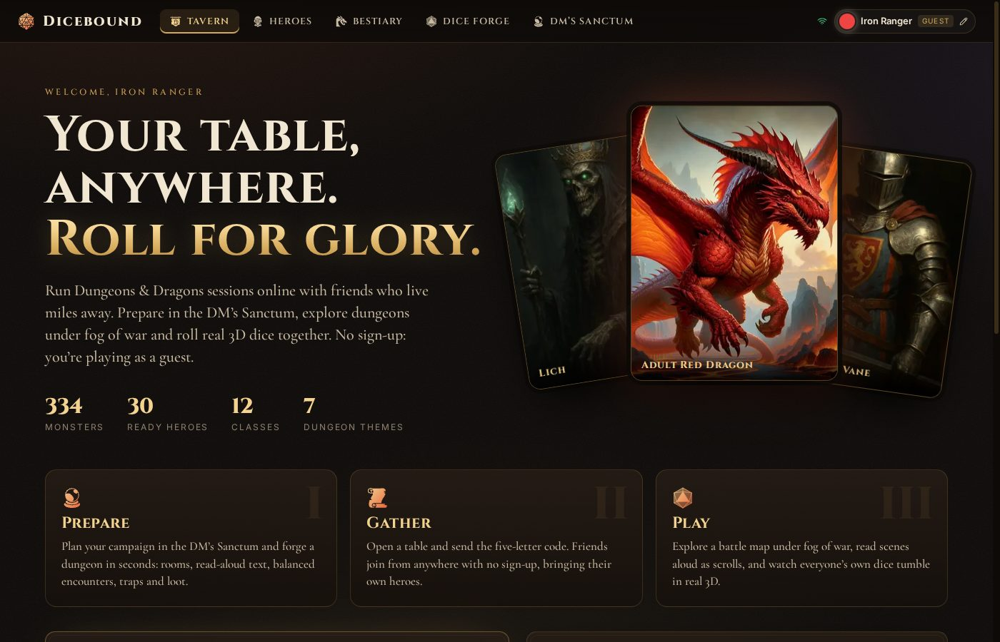
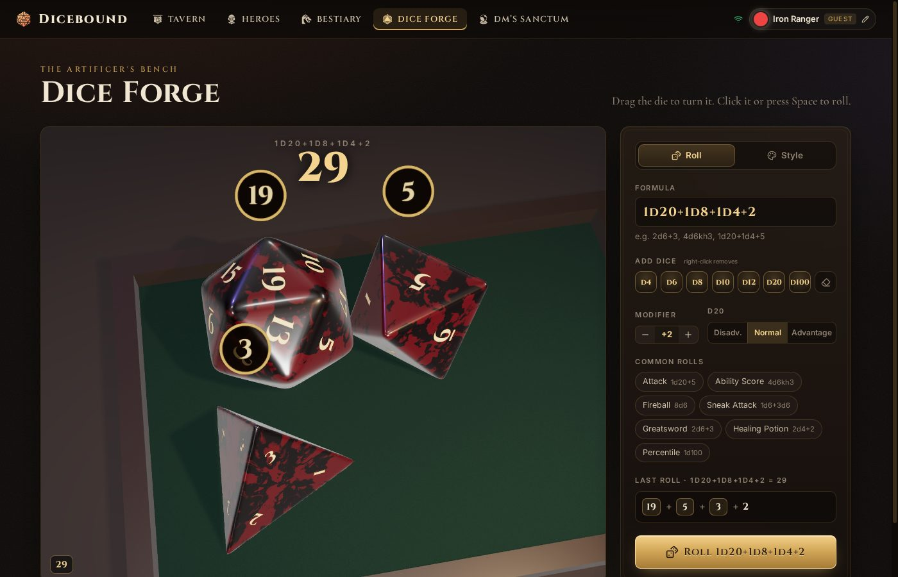
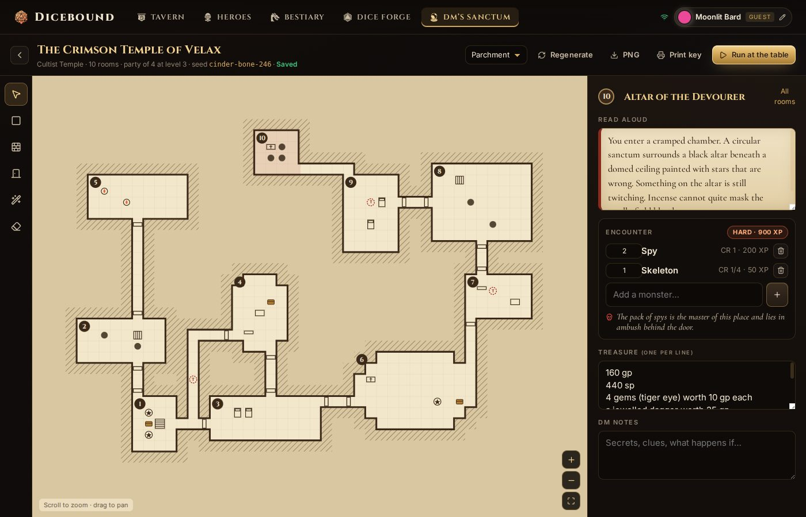
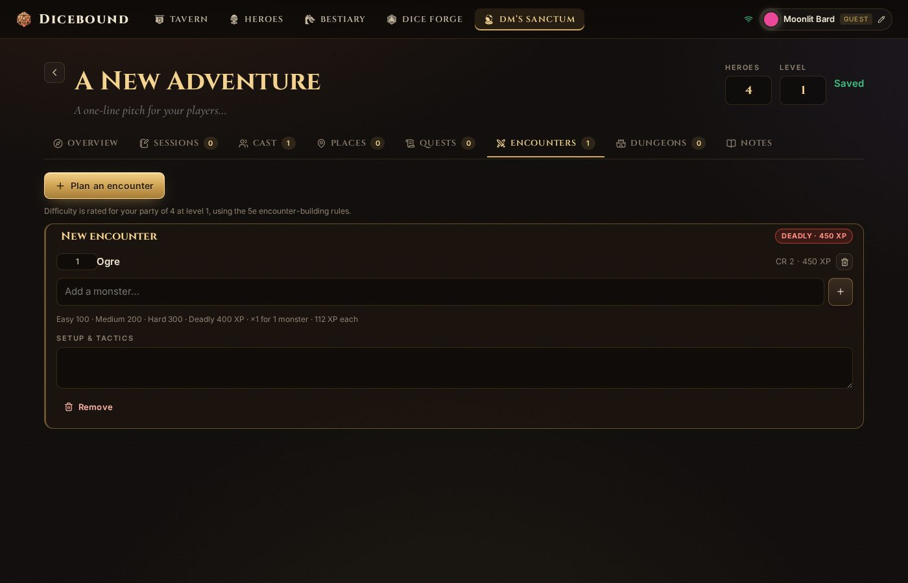
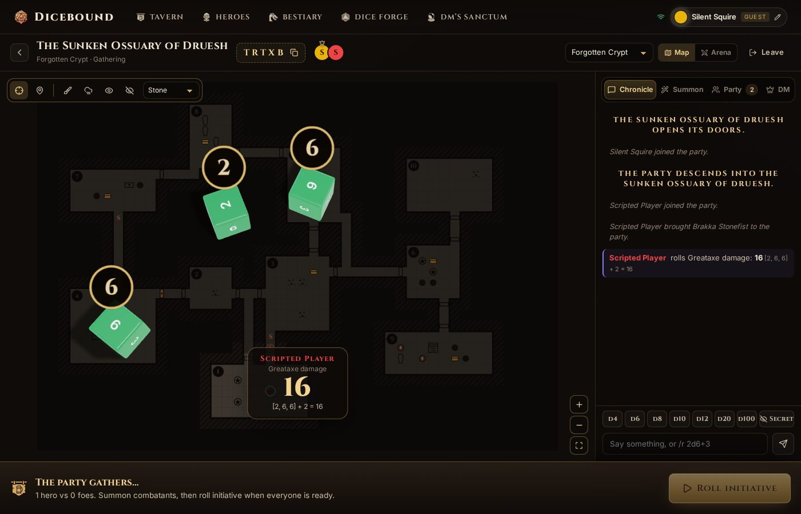
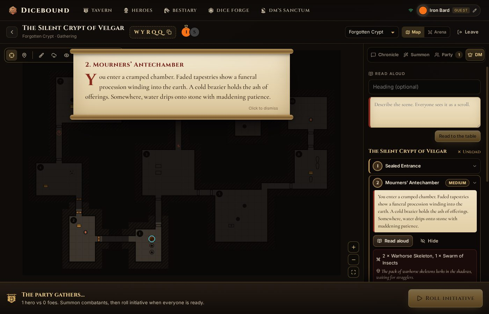

# Dicebound

**Run Dungeons & Dragons 5e sessions online with friends who can't meet up.**

The Dungeon Master plans campaigns and forges whole dungeons in seconds. Everyone then meets at a
live table: a battle map under fog of war, read-aloud narration, and real 3D dice that every
player watches tumble. There's no sign-up; everyone plays as a guest.



## Features

### 🎲 Dice Forge
Physically simulated 3D dice you can make your own.

- Roll any formula: `1d20+5`, `2d6+3`, `4d6kh3`, `1d20+1d4+5`, with advantage or disadvantage.
- Throw up to 8 dice at once, with a floating result over each. A d100 is a real tens die plus a units die.
- Results are rolled first. The physics decides how the dice tumble, then the numbering is rotated
  using the die's own symmetry so the rolled value lands face up. Cocked or stacked dice are re-thrown.
- Customise the finish (resin, marbled, pearl, metal, glass, gemstone), colours, edge rounding,
  numeral font, numeral glow and the dice tray. Shapes morph smoothly into one another.
- A synthesised clatter plays in time with each impact.



### 🏰 The DM's Sanctum
Everything behind the screen, in one place.

- **Campaign planner:** the setting and premise, session prep and recaps, NPCs with DM-only secrets,
  places, and quests with a status.
- **Encounter builder:** rates difficulty for your party using the 5e XP thresholds and multipliers.
- **Dungeon generator:** pick one of 7 themes (crypt, caverns, bandit stronghold, sewers, cult temple,
  volcanic lair, fey ruin), a size, and your party. You get:
  - rooms and corridors, with doors that can be locked, secret or portcullised;
  - furniture, and read-aloud text for every room;
  - encounters balanced to your party, plus traps and treasure scaled by tier;
  - adventure hooks and a wandering monster table.
  - The same seed always builds the same dungeon.
- **Dungeon editor:** paint floors and walls, place doors and furniture, and edit the room key. Export the map as a PNG,
  print the room key, or hit **Run at the table** to play it straight away.





### 🗺️ The live table
- **Joining:** tables have five-letter codes. Players bring their heroes, and the DM summons any monster.
- **Battle map:** fog of war that the DM lifts room by room or with a brush. Tokens can be dragged and show HP rings,
  anyone can ping a spot, and a room's planned encounter spawns into that room with one click.
- **Narration:** the DM's read-aloud text unrolls as a parchment scroll for everyone.
- **Secret rolls:** a toggle so the DM can roll where only they see the result.
- **Shared dice:** every table roll is made by the server and replayed as 3D dice on every screen, in
  the roller's own dice style.
- **Combat engine:**
  - initiative, Extra Attack and Multiattack;
  - advantage and disadvantage, crits, and saving-throw spells;
  - recharge abilities and limited uses;
  - conditions that change the maths;
  - death saves, potions and victory XP.





### 📜 Heroes and bestiary
- **Character sheets:** 12 races, 12 classes, levels 1–20, skills, saves and editable attacks and spells.
- **Premade heroes:** 30 ready-made adventurers, at least one for every class.
- **Bestiary:** all 334 SRD monsters with artwork and classic stat blocks. Duplicate any of them, or build your own.

## Fair play
The server is authoritative. Every die at the table is rolled on the server, and players can only
act for the combatants they brought. Players' browsers only ever receive the public half of the
map: room descriptions, encounters, traps and undiscovered secret doors stay with the DM.

## Running it

You need **Node 22.13 or newer** (the database uses Node's built-in `node:sqlite`).

```bash
npm install
npm run dev          # API on :3001, app on http://localhost:5173
```

Production build (one process serves everything on :3001):

```bash
npm run build
npm start
```

### Playing with friends far away
Friends need to reach your machine. On the same network, share `http://<your-ip>:5173/table/<CODE>`.
Over the internet, put a tunnel in front of the server, for example:

```bash
npm run build && npm start
ngrok http 3001      # share the https URL it prints
```

## Project layout

```
shared/   rules, dice engine, schemas, 5e encounter maths, dungeon generator, heroes, bestiary.json
server/   Express REST API, Socket.IO battle engine and battle map (src/game.js), SQLite store (src/db.js)
client/   React + Vite + framer-motion UI
          ├ src/pages/forge   three.js dice, cannon-es physics (in a Web Worker)
          ├ src/pages/dm      DM's Sanctum: campaigns, dungeon editor, generator
          └ src/pages/table   live table: arena, battle map, DM panel, shared dice
scripts/  import-srd.mjs re-imports monsters and artwork from dnd5eapi.co
```

Data lives in `server/data/dicebound.sqlite` (set `DATA_DIR` to move it).

## Tech
React 18, Vite, framer-motion, three.js, cannon-es, Express 5, Socket.IO and SQLite (`node:sqlite`).

## Credits
- Monster statistics and artwork: [D&D 5e SRD API](https://www.dnd5eapi.co) (SRD 5.1, CC BY 4.0).
- Icons: Lorc and Delapouite, [game-icons.net](https://game-icons.net) (CC BY 3.0).

Dicebound is an unofficial fan project, not affiliated with or endorsed by Wizards of the Coast.
